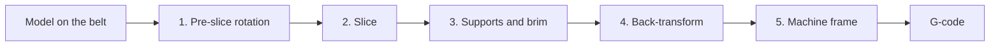

# Belt Printing

A belt printer (also called a conveyor or "infinite Z" printer) replaces the fixed bed with a moving belt and tilts the gantry over it, usually by 45°. Because the belt carries printed material away from the nozzle, a part can be longer than the machine, and a series of parts can be printed without clearing the bed between them.

OrcaSlicer supports these machines with a dedicated belt printer mode, used by printers such as the Printcepts BabyBelt Pro, the IdeaFormer IR3 V2 and CR-30 style machines. This guide explains how that mode works and what changes in your workflow. The individual options are described in [Belt printer]({{L1}}) and [Machine frame transforms]({{L2}}).

{{T1}}

## How a belt printer differs

A slicer normally assumes that the bed lies in the XY plane and that layers stack along Z. A belt printer differs in both respects:

- **The layers are tilted.** The nozzle moves in the plane of the tilted gantry, so every layer is a slanted plane that starts on the belt and rises in the direction of belt travel.
- **The belt is an axis.** The motor that advances the belt is the printer's Z axis and the gantry height is its Y axis, so the "bed" lies in the machine's XZ plane and is, in principle, endless.

{{I1}}

## Setting up a belt printer

To enable belt mode, select [Enable belt printing]({{L3}}) in **Printer settings → Basic information → Belt printer**. The group is only shown when the settings mode is **Advanced** or higher. With the option disabled, OrcaSlicer uses its standard printing behavior.

{{I2}}

### Starter profiles

| Printer | Vendor | Nozzles | Processes | Filaments |
| --- | --- | --- | --- | --- |
| Generic Belt Printer | Custom | 0.2, 0.4, 0.6, 0.8 | 0.20mm Standard, 0.12mm Fine | Filament library |
| BabyBelt Pro | Printcepts | 0.4 | 0.20mm Standard | Generic PLA, Generic PETG, eSUN PLA |
| IdeaFormer IR3 V2 | IdeaFormer | 0.4 | 0.20mm Standard | Generic PLA, Generic PETG, eSUN PLA |

### A printer that is not listed

1. Add the **Generic Belt Printer** from the **Custom** vendor.
2. In [Printable space]({{L4}}), set the printable area to match your belt: **X** is the width across the belt and **Y** is the belt length to display as one plate.
3. Set the [Printable height]({{L5}}) to the clearance under the gantry. On a belt printer, this limits the part's height above the belt, not its length along the belt.
4. Check the [Belt tilt]({{L6}}) angle against your machine and save the profile.
5. Enter your machine's [start and end G-code]({{L7}}) and [motion limits]({{L8}}), then tune the profile for your machine.

> [!TIP]
> The belt options are available as [placeholders]({{L9}}) in custom G-code. The BabyBelt Pro profile, for example, passes the tilt to its start macro with `PRINT_START ANGLE=[belt_slice_rotation_angle] ...`.

> [!WARNING]
> Start, end and other custom G-code is written to the file unchanged. It is not rotated or remapped, so write it in machine coordinates: Y is the gantry and Z is the belt.

## How OrcaSlicer slices for a belt

OrcaSlicer uses its existing slicing engine by transforming the model before slicing and the resulting toolpaths afterward.

### 1. Pre-slice rotation

The model is rotated by the [belt tilt]({{L10}}) before it is sliced. Slicing the rotated model into horizontal layers produces layers that are tilted relative to the original model. This rotation preserves the model's shape and dimensions.

### 2. Slice

The rotated model is sliced using the standard process, so walls, infill, seams, ironing, painting and most other features work on a belt without belt-specific settings.

### 3. Supports and brim

In the rotated coordinate system, the belt is a tilted plane rather than the plane at Z = 0. Supports and the brim are generated relative to that plane:

- Normal, tree and organic supports end on the belt surface, and nothing is generated below it. Under an overhang at the leading end of a part they reach the belt ahead of the part's first contact with it, so the support can start before the part itself.
- The brim is printed on the belt, with each layer contributing one strip.

### 4. Back-transform

When the toolpaths are written, every point is rotated back into the coordinate system of the model as placed in Prepare, so the next step receives the coordinates shown in Prepare.

### 5. Machine frame

The firmware does not account for the tilted gantry, so OrcaSlicer converts the coordinates into the required motor positions in two steps:

1. The [G-code axis remap]({{L11}}) swaps the axes. In the belt profiles, the height above the belt becomes machine Y, the position along the belt becomes machine Z, and X is reversed.
2. The [machine-frame tilt]({{L12}}) scales the gantry coordinate and shifts the belt coordinate so that a vertical wall in the model prints vertically.

## Working with a belt printer

### Placing and arranging parts

In Prepare, the plate represents the belt surface, shown flat. X runs across the belt, Y runs along it and Z is the height above the belt, so parts are placed and oriented as on any other printer. The part closest to Y = 0 is printed first.

{{I3}}

- With [Infinite Y axis]({{L13}}) enabled, a part may extend beyond the displayed plate along Y.
- A part must fit the belt width, and its height must fit under the gantry ([Printable height]({{L14}})).
- [Auto arrange]({{L15}}) places parts starting at the end of the belt that prints first. It groups parts that use the same filament so each filament change occurs once, and it leaves room for the brim and the [belt purge tower]({{L16}}).

> [!TIP]
> Part orientation affects overhangs differently than on a flat bed. Each layer is printed against the previous one, progressing from the end of the part that prints first toward the end that prints last. An overhang that points back along the belt is printed onto existing material, while an overhang at the leading end of the part starts in mid-air and needs support.

### First layer

On a flat bed, the first layer is the first slice. On a belt, every tilted layer touches the belt along a narrow strip, so the "first layer" is a band along the belt surface that extends through the entire print.

OrcaSlicer applies first-layer speed, acceleration, jerk and temperature to extrusions inside that band, which is one [first layer height]({{L17}}) thick. Settings that count layers, including the number of layers printed [without cooling]({{L18}}), count bands of that thickness above the belt surface instead.

### Brim

Each layer meets the belt along a single line, so a [brim]({{L19}}) is more useful than on a flat bed. Three options are specific to belt printers:

{{I4}}

- [Leading length]({{L20}}) extends the brim ahead of the part, anchoring the leading edge to material already attached to the belt.
- [Extra width]({{L21}}) widens the brim across the belt.
- The [Leading edge only]({{L22}}) brim type limits the brim to the area where the part first contacts the belt.

### Supports

All [support types]({{L23}}) can be used and terminate at the belt surface. [Painted supports]({{L24}}) and [painted seams]({{L25}}) follow the same rotation as the model.

### Multi-color printing

The standard [prime tower]({{L26}}) cannot be printed on a belt. It is replaced by the [belt purge tower]({{L27}}), a long, thin object that OrcaSlicer adds beside the parts along the far edge of the belt. Material is purged into this object at every filament change.

{{I5}}

### Preview

The preview shows the toolpaths in the model's coordinate system, so the part appears upright as designed. To see the coordinates written to the G-code instead, enable **Show raw G-code (belt only)** in the view menu of the preview canvas (the eye icon in the toolbar), or press `B`. The layers then lie along the belt axis the way the machine prints them. This only changes the preview; the exported G-code is the same either way.

{{I6}}
{{I7}}
{{I8}}

### Calibration

- The [temperature tower]({{L28}}) dialog offers a **Test model** selection on belt printers: **Standard** or **Overhang**.
- For [pressure advance]({{L29}}), only the **PA Tower** method is enabled on belt printers.

{{I9}}

## Features that are not available

Some features are incompatible with belt printing or would cause unsuitable belt movements. OrcaSlicer disables these features in the settings or prevents slicing when they are enabled.

| Feature | On a belt printer |
| --- | --- |
| [Skirt]({{L30}}) | Disabled. No skirt is generated. |
| [Raft]({{L31}}) | Slicing is blocked when raft layers are configured. |
| Draft shield | Slicing is blocked when enabled. |
| [Prime tower]({{L32}}) | Never generated. Use the [belt purge tower]({{L33}}). |
| [Arc fitting]({{L34}}) | Disabled. The machine-frame transform turns a circle into an ellipse, which G2/G3 cannot represent. |
| [Scarf joint seam]({{L35}}) | Disabled. The scarf would start inside the previous layer. |
| [Spiral vase]({{L36}}) with a brim | Incompatible with belt brims, which extend across layers beyond Z = 0. |
| [Z hop]({{L37}}) | Set to 0 in the belt profiles because lifting away from a tilted layer requires belt movement, which can cause problems on most belt printers. |
| Brim types Auto, Mouse ears and Painted | Printed as an outer brim. See [Brim]({{L38}}). |
| PA Line and PA Pattern calibration | Unavailable. Use PA Tower. |

## Fun things to try

You can print a cube with all its walls in vase mode.
