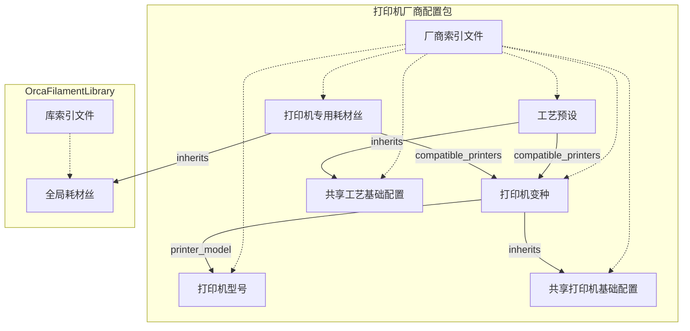

# 指南：为 OrcaSlicer 开发配置文件

本指南讲解 OrcaSlicer 的配置文件系统，以及如何在源代码检出中创建或维护随软件发布的打印机、耗材丝和工艺配置文件。

{{T1}}

## 总体概览

### 三种预设共同描述一次打印

**配置文件**（profile）也称**预设**（preset），是保存在 JSON 文件中的一组命名设置。准备一次打印需要组合三类预设：

| 预设 | 回答的问题 | 典型设置 |
| --- | --- | --- |
| 打印机（`machine`） | 我在什么硬件上打印？ | 热床尺寸、喷嘴直径、运动限制和机器 G-code |
| 耗材丝（`filament`） | 我用什么材料打印？ | 温度、冷却、流量比例和最大体积速度 |
| 工艺（`process`） | 零件应该怎样打印？ | 层高、墙、填充、支撑和打印速度 |

例如，用户可能会选择 `Orca 3D Fuse1 0.4 nozzle`、`Generic PLA @System` 和 `0.20mm Standard @Orca 3D Fuse1 0.4`。修改层高属于工艺配置；修改材料的温度属于耗材丝配置。这些设置分开保存，同一台打印机就可以搭配多种材料和质量等级。

### 型号、变种和配置包

**打印机型号**（`machine_model`）描述一款产品，例如 `Orca 3D Fuse1`。它列出可用的喷嘴变种，并引用 3D 视图中使用的热床模型和纹理。**打印机变种**（`machine`）是切片时实际使用的打印机预设，例如 `Orca 3D Fuse1 0.4 nozzle`。一个型号可以有多个变种。

**厂商配置包**把相关的配置文件组织在一起。它由一个存放配置文件的文件夹，以及一个与之对应的 JSON **索引文件**组成；索引文件列出这些配置文件，并保存配置包的版本。把新文件放进文件夹只完成了一半工作，你还必须在索引中登记它。

`OrcaFilamentLibrary` 是一个共享配置包，包含通用耗材丝和各品牌耗材丝的配置文件。打印机配置包可以使用这些材料并继承其设置。只有当你有针对某台打印机调校过的材料设置时，才需要打印机专用的耗材丝配置文件。

### 继承让设置得以复用

`inherits` 字段指定父配置文件。OrcaSlicer 先解析父配置的设置，再在其上应用子配置的值。子配置省略的任何设置都保留继承来的值。父配置本身也可以继承其他配置文件。

**共享基础配置**为其他配置文件保存设置，不能在界面中选择（`"instantiation": "false"`）。**可选预设**提供用户可以选择的配置（`"instantiation": "true"`）。两者都可以作为其他配置文件的父配置。

例如，多个工艺配置文件可以继承 `fdm_process_common`。这个公共基础配置保存共用的设置，而每个子配置提供自己的层高和质量调整。修改公共基础配置，会影响所有没有覆盖该设置的子配置。

打印机和工艺配置文件在各自的厂商配置包内部继承。耗材丝配置文件还可以继承 `OrcaFilamentLibrary` 中的配置。

### 兼容性决定预设在哪里可用

继承和兼容性回答的是不同的问题：`inherits` 说明设置从哪里来；`compatible_printers` 列出可以使用某个耗材丝或工艺预设的打印机变种。

一个全局耗材丝可以服务于许多打印机。当某个打印机专用耗材丝与某个全局耗材丝具有相同的**别名**时，OrcaSlicer 会在其列出的打印机上改用这个打印机专用的耗材丝。别名通常取自名称中 `@` 之前的部分：在受支持的 Fuse1 变种上，`Generic PLA @Orca 3D Fuse1` 会取代 `Generic PLA @System`。其他打印机仍然使用全局配置。

### 各文件之间的关系

下图中的每个方框代表一个 JSON 文件。虚线箭头表示厂商索引登记了某个配置文件；实线箭头表示通过命名字段建立的引用。示例中还包括一个从全局耗材丝继承设置的厂商耗材丝。

耗材丝的 `inherits` 箭头用于复用设置。取代全局备选配置则是另一回事：它来自共用别名并列出目标打印机，这种取代并不需要继承关系。

### 两种 ID 各有用途

| ID | 标识的对象 | 示例 |
| --- | --- | --- |
| `setting_id` | 一个可选预设 | PolyLite PLA 的两个打印机专用预设具有不同的设置 ID |
| `filament_id` | 一款耗材丝产品，由它的各个预设共用 | 这些 PolyLite PLA 预设共用同一个耗材丝 ID |

[配置工具]({{L1}})会生成这两个值；详情参见[设置 ID]({{L2}})和[耗材丝 ID]({{L3}})。

## 文件结构与模板

在你的 **OrcaSlicer 源代码检出**中编辑 `resources/profiles/`。这里是随应用程序发布的配置文件的来源。示例使用一个虚构的厂商 `Orca 3D` 及其 `Fuse1` 打印机，从 0.4 mm 喷嘴开始。

{{C1}}

每个配置文件的文件名是它的 `name` 加上 `.json`。在厂商索引中以及从其他配置文件引用时，都要使用同一个名称。

| 文件或配置文件 | 命名模式 | 示例 |
| --- | --- | --- |
| 厂商索引文件 | `<vendor>` | `Orca 3D` |
| 打印机型号 | `<vendor> <printer>` | `Orca 3D Fuse1` |
| 打印机变种 | `<vendor> <printer> <nozzle> nozzle` | `Orca 3D Fuse1 0.4 nozzle` |
| 耗材丝 | `<product name> @<target>` | `Generic ABS @Orca 3D Fuse1` |
| 工艺 | `<layer height> <quality> @<target>` | `0.20mm Standard @Orca 3D Fuse1 0.4` |

工艺的质量名称通常是 Standard、Fine、Fast 或 Draft。耗材丝的目标通常是 `System`、某个打印机型号或某个打印机变种。目标后缀说明预期用途；兼容性仍然由配置文件的字段控制。

模板位于 `resources/profiles_template/Template/`。现有的配置包也是很有用的示例，尤其是与你的打印机硬件相近的那些。改编时，请检查它的固件、尺寸、运动限制和 G-code，不要想当然地认为所有设置都适用于你的打印机。

> [!TIP]
> 使用简短的厂商名称，让文件名便于管理。本指南中的路径使用 `/`；请使用你的操作系统对应的路径分隔符。

### 通用配置字段

打印机、耗材丝和工艺 JSON 文件都使用以下字段。`machine_model` 是单独的元数据记录。

| 字段 | 取值 |
| --- | --- |
| `inherits` | 父配置的确切 `name`，不带 `.json`，也不带目录路径 |
| `instantiation` | 共享基础配置为 `"false"`；可选预设为 `"true"` |
| `from` | 随 OrcaSlicer 发布的配置文件为 `"system"` |
| `compatible_printers` | 仅限耗材丝和工艺：完整打印机变种名称的数组，例如 `["Orca 3D Fuse1 0.4 nozzle"]` |

JSON 字段名要加引号，并保持模板中使用的值类型，包括字符串 `"true"` 和 `"false"`。文件夹名称或 `@System`、`@base` 之类的后缀并不会建立继承关系；请用 `inherits` 指定父配置。

在可选的耗材丝和工艺配置文件上显式设置兼容性。使用打印机变种名称，而不是型号名称或文件名。打印机厂商的耗材丝必须有非空列表；全局库可以使用空列表，但要受兼容性条件和打印机专用预设取代规则的约束。

## 创建或更新配置包

选择能实现目标的最小改动：

| 你的目标 | 需要添加或更新的内容 |
| --- | --- |
| 支持一款新打印机 | 型号、它的打印机变种、兼容的工艺，以及厂商索引 |
| 为现有打印机增加一种喷嘴尺寸 | 型号的喷嘴列表、一个打印机变种、匹配的工艺，以及相关耗材丝的兼容列表 |
| 增加一种通用材料或耗材丝产品 | `OrcaFilamentLibrary` 中的配置文件和索引条目 |
| 为某台打印机调校现有材料 | 在相应的库中添加一个打印机专用耗材丝配置文件，并显式设置兼容性 |
| 调整现有预设 | 修改它自身的覆盖值；如果改动应适用于所有子配置，则修改共享基础配置 |

对于新打印机，按以下步骤进行：

1. **选择配置包和父配置。** 如果该打印机厂商的配置包已存在，就复用它。对于新厂商，创建其文件夹和索引文件。确定或创建共享的打印机和工艺基础配置。
2. **描述硬件。** 添加打印机型号，然后为每种受支持的喷嘴配置各添加一个打印机变种。让变种的 `printer_model` 与型号名称一致。
3. **添加可用的工艺。** 为每个变种创建工艺，并在 `compatible_printers` 中列出该变种。把打印机的 `default_print_profile` 设为该工艺的确切名称。
4. **选择材料。** 从全局耗材丝库开始。只为你调校过的材料添加打印机专用配置文件，并把打印机的默认耗材丝设为一个可用的预设。
5. **登记文件。** 把新的配置文件（包括共享基础配置）添加到[厂商索引文件]({{L4}})中对应的列表里，或者让[配置工具]({{L5}})根据磁盘上的文件写出这些列表。一并检查名称、路径和引用。
6. **生成 ID 并为更新标注版本。** 运行[配置工具]({{L6}})；当耗材丝条目或标识发生变化时更新耗材丝快照，并把每个改动过的配置包的 `version` 最后一段加一。
7. **验证并试用配置文件。** 运行[配置检查]({{L7}})，在 OrcaSlicer 中加载改动后的资源，检查切片后的模型，并在目标打印机上测试这些设置。编辑共享基础配置时，要测试所有受影响的变种。

如果只改动耗材丝，请参考相关的[耗材丝示例]({{L8}})，然后完成登记、生成 ID、更新版本和验证。下面的 JSON 示例展示的是结构和部分设置，并不是针对真实打印机的完整、经过测试的配置。除非某节明确展示了生成的 ID，示例中都省略了 ID，以便你在确定自己的名称后再运行工具。

## 厂商索引文件

每个配置包在其文件夹旁边都有一个 `resources/profiles/<vendor>.json` 索引文件。OrcaSlicer 读取这个文件来查找要加载的配置文件。把每个配置文件（包括不可选择的基础配置）登记到相应的列表中：

| 列表 | 包含 |
| --- | --- |
| `machine_model_list` | 打印机型号（`machine_model`） |
| `machine_list` | 打印机变种和共享打印机基础配置（`machine`） |
| `process_list` | 可选工艺和共享工艺基础配置（`process`） |
| `filament_list` | 可选耗材丝和共享耗材丝基础配置（`filament`） |

每个条目的 `name` 与配置文件的名称一致。它的 `sub_path` 相对于厂商文件夹，而不是相对于 `resources/profiles/`。例如，对于上面展示的文件，`Orca 3D.json` 如下：

{{C2}}

如果只使用全局耗材丝，请让 `filament_list` 保持为空；不要把它们的条目复制到打印机配置包中。为全局库本身做贡献时，才把它们添加到 `OrcaFilamentLibrary.json`。

OrcaSlicer 只读取这里列出的 `sub_path`，别无其他，所以没有被任何列表提到的配置文件永远到不了用户手中，无论文件本身多么正确。[配置工具]({{L9}})可以替你写出这些列表：

{{C3}}

它读取配置包文件夹中的每个文件，按文件自身的 `type` 把它放进对应的列表，并把每个列表按"父配置在前"的顺序排列，使加载器能一次性解析完 `inherits`。[配置检查]({{L10}})会报告没有被任何列表引用的文件，以及同一个配置包中声明了相同配置名称的两个文件——其中只有一个能被索引，加载器会悄无声息地忽略另一个。

更新配置包时，把其现有 `version` 的最后一段加一，例如 `01.00.00.00` → `01.00.00.01`，这样用户才会收到配置更新。除非你的改动需要更新，否则保留配置包的其他元数据不变。

## 打印机型号配置文件

`machine_model` 描述打印机产品及其可用的变种。它位于 `resources/profiles/<vendor>/machine/` 中，并登记在 `machine_model_list` 里。

{{C4}}

如果有多种喷嘴尺寸，请使用分号分隔的字符串，例如 `"0.2;0.4;0.6;0.8"`，并添加相应的打印机变种。这里的 `nozzle_diameter` 用于声明可用的尺寸；下面的变种配置文件设置的才是切片时实际使用的喷嘴。`default_materials` 列出该型号的默认材料选项，同样用分号分隔。

### 模型

`bed_model` 和 `bed_texture` 引用的资源文件相对于厂商文件夹。把引用的 STL 和 SVG 文件放在该配置包中；如果你把资源放在 `model/` 之类的子文件夹中，就使用相对的子文件夹路径。这些资源描述热床的外观；打印机变种的 `printable_area` 才定义可打印的边界。

厂商文件夹中还可以放一张 240×240 px 的图片，命名为 `<machine_model_list.name>_cover.png`，例如 `Orca 3D Fuse1_cover.png`，用于界面中的打印机选择。

## 打印机变种配置文件

`machine` 配置文件定义一种可选择的硬件配置。它与型号一起位于 `resources/profiles/<vendor>/machine/` 中，但登记在 `machine_list` 里。

从 `fdm_machine_common` 之类的共享打印机基础配置开始。把你的各款打印机共用的设置放在这个基础配置中，把该变种特有的设置放在它自己的文件里：

{{C5}}

`printer_model` 把这个预设关联到型号记录。`inherits` 把它关联到其设置基础配置；型号记录并不是那个基础配置。

`printer_variant` 必须与所关联型号的分号分隔 `nozzle_diameter` 列表中的某一项完全一致。验证器还会检查变种中的数字直径是否与该机器预设的 `nozzle_diameter` 相符。例如，`"0.8HF"` 标识一种使用 0.8 mm 喷嘴的硬件变种，而 `"0.4+0.6"` 描述一种有两种喷嘴直径的变种。

与型号中分号分隔的喷嘴列表不同，机器预设使用数组，例如 `["0.4"]`。请保持现有配置文件和模板中使用的值类型。默认耗材丝和默认工艺的名称必须能解析到该打印机可用的预设。

## 工艺配置文件

工艺配置文件定义打印质量和打印行为。它们位于 `resources/profiles/<vendor>/process/` 中，并登记在 `process_list` 里。不存在在所有打印机配置包之间共享的全局工艺配置文件。

共享基础配置使用 `"instantiation": "false"`。可选的质量预设继承这个基础配置并设置自己的值。下面的示例为 0.4 mm 打印机变种设置 0.20 mm 层高：

{{C6}}

名称只是帮助用户识别质量等级，并不会设置层高；设置层高的是 `layer_height` 字段。其他 Fine 或 Draft 配置文件可以继承同一个基础配置，并覆盖各自的层高、速度和其他质量设置。

## 耗材丝配置文件

耗材丝配置文件保存材料设置，并登记在某个配置包的 `filament_list` 中。根据由谁维护这些设置、它们适用于什么来选择存放位置：

| 贡献内容 | 在 `resources/profiles/` 下的位置 |
| --- | --- |
| 适用于所有打印机的通用材料 | `OrcaFilamentLibrary/filament/` |
| 某耗材丝品牌的产品，包括其针对特定打印机的调校 | `OrcaFilamentLibrary/filament/<brand>/` |
| 打印机厂商为自家打印机调校的材料 | `<vendor>/filament/` |

> [!IMPORTANT]
> 只有当你确实针对某台打印机调校过耗材丝时，才创建打印机专用耗材丝配置文件。否则请使用全局库：对全局库的改进会惠及所有使用它的打印机。

### 向全局库添加耗材丝配置文件

通用耗材丝放在 `resources/profiles/OrcaFilamentLibrary/filament` 中。品牌耗材丝放在该品牌自己的子文件夹中，参见[添加耗材丝品牌]({{L11}})。如果有现成的基础类型，就继承它。

下面的示例添加 `Generic PLA-GF @System`：

1. 创建 `Generic PLA-GF @System.json`。让 `compatible_printers` 保持为空，使其对所有打印机可用，并且不要写 `setting_id` 和 `filament_id`。

    {{C7}}

2. 把这个条目添加到 `resources/profiles/OrcaFilamentLibrary.json` 中现有的 `filament_list` 里，保留其他条目：

    {{C8}}

3. 生成 ID 并更新快照（参见[生成 ID]({{L12}})）：

    {{C9}}

    工具会添加两个 ID。`Generic`（继承自基础配置）、`PLA-GF` 和 `Generic PLA-GF` 得出的 ID 是 `OFkuMukj`：

    {{C10}}

4. 提升 `OrcaFilamentLibrary.json` 中的版本号，并[验证配置文件]({{L13}})。

### 添加耗材丝品牌

耗材丝品牌（例如 Polymaker）把它所有的配置文件都放在全局库中属于自己的子文件夹里，绝不向打印机厂商的文件夹中添加配置文件：

{{C11}}

适用于所有打印机的配置文件直接放在 `Polymaker` 中。针对特定打印机调校的配置文件放在以该打印机厂商文件夹命名的子文件夹中，例如 `BBL` 或 `Qidi`。把它们全部登记在 `OrcaFilamentLibrary.json` 中，`sub_path` 里要带上子文件夹，例如 `filament/Polymaker/BBL/PolyLite PLA @BBL P1S 0.4 nozzle.json`。

从一个不可选择的产品基础配置开始。把 `filament_vendor` 设为该品牌，并继承最接近的材料基础配置：

{{C12}}

然后添加适用于所有打印机的可选配置文件。继承产品基础配置，并让 `compatible_printers` 保持为空：

{{C13}}

只有当你针对某台打印机调校过这款耗材丝时，才添加打印机专用配置文件。保持 `PolyLite PLA` 这个名称，继承 `PolyLite PLA @base`，并在 `compatible_printers` 中列出打印机变种：

{{C14}}

在那台打印机上，这个配置文件会取代 `PolyLite PLA @System`。两者都是耗材丝 `PolyLite PLA`，因此这个配置文件继承相同的 `filament_id`，即 `OF5CgdDq`。

在 `OrcaFilamentLibrary.json` 中登记基础配置和所有可选配置文件，包括目录树中 Qidi 示例那样的其他打印机专用配置文件。提升库的版本号，然后[生成 ID 并验证]({{L14}})。请运行完整检查：只检查单个厂商时，这些配置文件会检查失败，参见[只检查一个厂商]({{L15}})。

### 向打印机厂商库添加耗材丝配置文件

打印机厂商管理自己的厂商文件夹，包括 `resources/profiles/<vendor>/filament` 中的耗材丝配置文件。耗材丝品牌不在这里添加配置文件，参见[添加耗材丝品牌]({{L16}})。如果库中有现成的基础类型，就继承它，并设置非空的 `compatible_printers`。

下面的示例为 `Orca 3D Fuse1` 调校 `Generic ABS`。只需列出改动过的材料设置和目标打印机：

{{C15}}

这些数值只是用来说明覆盖的写法；请使用针对你的打印机测得的数值。只有当调校同样适用于其他喷嘴变种时，才把它们添加到 `compatible_printers` 中。

这个配置文件保留 `Generic ABS` 名称并继承 `Generic ABS @System`，因此可以继承库中的 `filament_id`。它仍然需要自己生成的 `setting_id`。厂商自有品牌的耗材丝属于不同的产品，需要自己的耗材丝 ID；参见[耗材丝 ID]({{L17}})。

在打印机厂商的 `filament_list` 中登记该文件，提升该配置包的版本号，然后[生成 ID、更新快照并验证]({{L18}})。

## 配置工具

`scripts/orca_profile_tool.py` 负责配置文件树的所有维护工作。请在检出目录的根目录中运行它。除 `update-snapshot` 之外，每条命令都接受 `--vendor <Vendor>` 以只处理一个配置包；每条会写入文件的命令都接受 `--dry-run`，只报告将会做什么而不写入任何内容。

| 命令 | 作用 |
| --- | --- |
| `check` | 验证配置文件树，包括 `normalize` 和 `update-index` 不会再做任何改动；CI 运行的就是它，参见[验证配置文件]({{L19}}) |
| `generate-id` | 写入每个配置文件的标识所对应的 [`setting_id`]({{L20}}) 和 [`filament_id`]({{L21}}) |
| `normalize` | 把配置文件改写成规范形式：补上缺失的 `type`，删除切片软件会忽略的键（包括写死在耗材丝配置中的打印速度），并调整键的顺序 |
| `trim` | 删除没有被任何 `<vendor>.json` 列表引用的配置文件 |
| `update-index` | 根据磁盘上的文件重建 `<vendor>.json` 中的 `*_list` 部分 |
| `update-snapshot` | 重新记录 `scripts/filament_id_snapshot.json` |

对于常见的贡献——添加或编辑配置文件——操作顺序如下：

{{C16}}

省略 `--vendor` 即可处理所有配置包。无论是否指定，`update-snapshot` 以及 `check` 中与 `setting_id` 和 `filament_id` 相关的部分都会读取整个配置文件树：它们描述的属性是任何单个配置包都无法回答的。

`normalize` 和 `update-index` 并不是可有可无的润色。它们定义了配置文件和 `<vendor>.json` 应有的样子；只要其中任何一个还会改动某些内容，`check` 就会失败——所以运行它们，才能产出可供审查的文件，而不是留给下一位维护者去运行、再把你的差异带进他们的改动中。请先运行 `normalize` 再运行 `update-index`：`normalize` 会写入 `type`，而 `update-index` 正是按 `type` 归档配置文件的。

`trim` 是唯一不在上述流程中的命令。它删除现有配置包已不再列出的配置文件，属于清理工作，而不是添加新配置文件流程的一部分。确实要运行它时，请在 `normalize` 之后、`update-index` 之前运行，因为它依据的是 `update-index` 即将重建的索引来判断。

> [!WARNING]
> `trim` 会删除索引中没有列出的所有配置文件——包括你刚添加但尚未登记的配置文件。请先登记你的文件，并在让它真正写入之前用 `--dry-run` 预览。

`python3 scripts/orca_profile_tool.py <command> --help` 会完整说明单条命令的用法。

## 设置 ID

每个可选的机器、耗材丝或工艺预设（`"instantiation": "true"`）都需要一个在所有 OrcaSlicer 配置文件中唯一的 `setting_id`。它由厂商文件夹、配置文件类型（`filament`、`process` 或 `machine`）和配置文件名称计算得出：

{{C17}}

不要手写或复制 `setting_id`。添加配置文件时不要带它，让[配置工具]({{L22}})来填写：

{{C18}}

对于新厂商和现有厂商，做法都一样。同一次运行还会为新耗材丝添加 [`filament_id`]({{L23}})；在没有变化的配置文件树上再次运行，不会改动任何内容。加上 `--vendor <Vendor>` 可以只处理一个厂商，`--setting-id` 只写入 `setting_id`，`--dry-run` 则只预览。

> [!IMPORTANT]
> - 基础配置（`"instantiation": "false"`）**不能**有 `setting_id`。
> - 重命名预设会改变它的 `setting_id`。重命名后请再次运行工具。
> - 本指南示例中的 ID 仅作说明。[配置检查]({{L24}})会在 ID 缺失或错误时失败，所以一定要运行工具。

> [!NOTE]
> 拓竹（`BBL`）预设是唯一的例外：它们保留来自 Bambu Studio 的 `G*` 设置 ID。这只涉及 `setting_id`。

## 耗材丝 ID

`filament_id` 标识一款耗材丝产品，例如 `PolyLite PLA` 或 `Generic PETG HF`。该产品的所有打印机变种和喷嘴变种，在每个厂商配置包中都共用同一个 ID。带有耗材丝系统的打印机（拓竹 AMS、Creality CFS、Qidi 料盒、Klipper、Snapmaker）用它把槽位中的料盘匹配到耗材丝预设。

### ID 如何生成

ID 是三个值的哈希，这三个值沿 `inherits` 链解析：

1. `filament_vendor`：耗材丝制造商（例如 `Polymaker`），或 `Generic`。不要仅仅因为预设是为某品牌打印机调校的，就把它换成打印机品牌。
2. `filament_type`：材料（例如 `PLA`）。
3. 耗材丝名称：预设名称中第一个 `@` 之前的部分，并去掉首尾空白。`MyBrand PLA @Orca 3D Fuse1` 和 `MyBrand PLA@HS` 的耗材丝名称都是 `MyBrand PLA`。

{{C19}}

结果总是 8 个字符，足够短，可以给 AMS 使用。同一款产品在任何地方都得到相同的 ID：`Polymaker` / `PLA` / `PolyLite PLA` 总是 `OF5CgdDq`。

> [!NOTE]
> 拓竹耗材丝遵循同样的规则。对于在 OrcaSlicer 和 Bambu Studio 中都存在的耗材丝，OrcaSlicer 维护着一份两套 ID 之间的映射文件。

> [!IMPORTANT]
> 绝不要手写或复制 `filament_id`。创建耗材丝时不要带它，让[配置工具]({{L25}})来添加。

### 我需要新的 ID 吗？

只有当用户会把它看作一款不同的料盘产品时才需要。

| 情况 | `filament_id` |
| --- | --- |
| 现有耗材丝的打印机变种或喷嘴变种 | 相同的 ID |
| 厂商调校的通用耗材丝（例如为你的打印机调校的 `Generic PLA`） | 使用库中的 ID：继承 `Generic PLA @System` 并保留 `Generic PLA` 名称 |
| 不同产品线（PLA、PLA Matte、PLA Silk、PLA HF） | 每条产品线一个新 ID |
| 新颜色 | 相同的 ID |
| 同一产品的另一种直径（1.75 mm、2.85 mm） | 新的 ID；给它一个不同的产品名称 |
| 针对另一款打印机型号的高速调校 | 相同的 ID |
| 在同一台打印机上与普通预设并列提供的高速预设 | 新的 ID（它需要自己的名称） |

无论预设是自己设置 `filament_id` 还是继承它，ID 都必须与该预设自身的厂商、类型和名称相符。`inherits` 传递的是设置，而不是标识：`Flashforge ABS Basic @FF C5` 继承 `Generic ABS @System`，但设置了自己的 `filament_vendor`，所以它有自己的 ID。

> [!WARNING]
> 具有相同 `filament_id` 的打印机专用预设，其 `compatible_printers` 中不能包含同一台打印机。否则在那台打印机上的料盘匹配会产生歧义，`validate_filament_subtypes` [检查]({{L26}})也会失败。全局备选配置不受此限制，因为在已有匹配的打印机专用预设覆盖的打印机上，OrcaSlicer 会隐藏全局配置，正如[兼容性]({{L27}})一节所述。

### 生成 ID

创建不带 `filament_id` 的耗材丝配置文件，然后运行：

{{C20}}

把配置文件与 `scripts/filament_id_snapshot.json` 一起提交。快照记录每个耗材丝 ID、它的产品标识，以及使用它的"配置包/耗材丝名称"组合，例如 `BBL/PolyLite PLA`。同一个配置包中该产品的多个打印机专用预设共用一个条目。CI 要求快照与根据配置文件推导出的状态一致。不要手动编辑它。

加上 `--vendor <Vendor>` 可以让 `generate-id` 只处理一个厂商，加上 `--filament-id` 则只写入 `filament_id`。如果跳过这个工具，CI 会失败并输出预期的 ID。

### 重命名或更正耗材丝

重命名耗材丝，或者修正它的 `filament_vendor` 或 `filament_type`，都会改变它的 ID。重命名时，把旧的预设名称写入 `renamed_from`，让现有项目和用户预设仍能找到它。这个字段是字符串：

{{C21}}

然后运行 `generate-id` 和 `update-snapshot`，并提交更新后的配置文件和快照。

> [!CAUTION]
> 旧 ID 不会被转发。保存着旧 ID 的打印机槽位或校准记录会退回按耗材丝类型匹配，直到用户重新选择该耗材丝。只有在修正真正的错误时，才改变耗材丝的标识。

## 测试配置文件改动

命令行验证器直接读取你检出目录中的配置文件。要在图形界面中检查同样的改动，请运行包含你编辑过的 `resources/profiles/` 的编译版本或测试安装版本。只编辑源代码检出，并不会更新另外安装的 OrcaSlicer。

OrcaSlicer 还会在其配置文件夹中保存系统配置。如果旧的缓存副本遮挡了你正在测试的资源：

1. 在 OrcaSlicer 中打开**帮助** → **打开配置文件夹**，然后关闭 OrcaSlicer。

    {{I1}}

2. 删除该配置文件夹中的 `system` 文件夹，让 OrcaSlicer 重新加载其系统配置。

    {{I2}}

3. 重启 OrcaSlicer，如有需要启用该打印机，并确认它的变种、默认工艺和兼容的耗材丝都按预期显示。
4. 切片一个有代表性的模型，检查预览和生成的 G-code，并在目标打印机上测试这些设置。自动检查无法确定打印质量，也无法验证实际机器的极限。

## 验证配置文件

在 OrcaSlicer 检出目录的根目录中运行配置检查。它们与 CI 在每个改动配置文件的拉取请求上运行的检查相同。

macOS 和 Linux：

{{C22}}

Windows：

{{C23}}

即使某项检查失败，所有检查也都会运行；只要有任何一项失败，脚本就会以错误退出。

| 检查 | 发现的问题 |
| --- | --- |
| [`profile_tool`]({{L28}}) | 重复的键、`vendor_name.json` 条目与配置文件互不匹配、同一个配置包中两个配置文件同名、错误的耗材丝 `compatible_printers`、[`normalize` 或 `update-index`]({{L29}}) 仍会改写的配置文件或索引，以及 [`setting_id`]({{L30}}) 或 [`filament_id`]({{L31}}) 错误 |
| `version_bump` | 改动过的配置包在 `vendor_name.json` 中的 `version` 不比改动前更新，或者不是四个数字。CI 会把拉取请求与它要合并进的分支比较；脚本则把你的检出与它从 `main` 分出时的提交比较（`--base REF` / `-Base REF` 可指定其他提交） |
| `validate_system` | 无法加载的配置文件，例如 JSON 错误、缺少父配置，或者耗材丝没有 `filament_id` |
| `validate_slice` | 自定义 G-code 错误，通过在每台打印机上切片一个测试立方体来发现 |
| `validate_filament_subtypes` | 同一台打印机上有两个耗材丝预设使用相同的 `filament_id` |
| `validate_custom` | 会破坏旧版 OrcaSlicer 所创建用户预设的改动 |

脚本需要 Python 3；在 macOS 和 Linux 上还需要 `curl` 和 `unzip`。

### 配置验证器

`validate_*` 检查需要 `OrcaSlicer_profile_validator`。如果在某个 `build*` 文件夹中找到本地编译的版本（优先使用 Release），脚本就使用它；否则会下载 CI 使用的每夜构建版，并缓存在 `.test/check_profiles/` 中。

每夜构建的 Linux 验证器只有 x86-64 版本。在 ARM64 Linux 上，请自行编译验证器。

### 选项

| `check_profile.sh` | `check_profile.bat` | 说明 |
| --- | --- | --- |
| `-v`、`--vendor NAME` | `-Vendor NAME` | 只检查一个厂商，名称与其 `vendor_name.json` 完全一致（例如 `"Co Print"`） |
| `-p`、`--profiles DIR` | `-ProfilesDir DIR` | 验证器检查使用的配置文件夹（默认为 `resources/profiles`） |
| `--validator BIN` | `-Validator BIN` | 使用这个验证器可执行文件（或设置 `ORCA_PROFILE_VALIDATOR`） |
| `--download` | `-Download` | 即使存在本地编译版本，也使用每夜构建的验证器 |
| `--refresh` | `-Refresh` | 重新下载验证器和测试数据 |
| `--work-dir DIR` | `-WorkDir DIR` | 存放下载内容和日志的文件夹（默认为 `.test/check_profiles`） |
| `-l`、`--log-level N` | `-LogLevel N` | 验证器的日志级别（默认为 `2`） |
| `-h`、`--help` | `-Help` | 显示帮助 |

要只运行部分检查，请把检查名称写在选项之后：`./scripts/check_profile.sh validate_system validate_slice`。

> [!TIP]
> 在 Windows 上，如果遇到 260 个字符的路径长度限制，请把 `-WorkDir` 设为一个较短的文件夹，例如 `D:\t`。

### 只检查一个厂商

{{C24}}

{{C25}}

只检查一个厂商更快，但 CI 检查的是整个配置文件树：

- `profile_tool` 仍会检查所有厂商的 ID，所以可能因为其他厂商的文件而失败。
- 对于没有打印机的厂商（例如 `OrcaFilamentLibrary`），会跳过 `validate_slice`。
- 当某个库配置文件列出了不在本次检查范围内的厂商的打印机时，验证器检查会以 `references unknown compatible_printers` 失败，因为只加载了被检查厂商的打印机。

在发起拉取请求之前，请运行完整检查。

### 阅读检查结果

运行结束时会给出一份摘要：

{{C26}}

失败的检查会显示 `FAIL` 及其日志路径。日志保存在 `.test/check_profiles/logs/<check>.log` 中。失败时，脚本还会写出 `.test/check_profiles/pr_comment.md`，与 CI 在拉取请求上发布的报告相同。

### 单独运行某项检查

要在脚本之外调试某项检查，请直接运行它的命令：

{{C27}}

给[配置工具]({{L32}})加上 `--vendor "Orca 3D"`，或给验证器加上 `-v "Orca 3D"`，即可只检查一个厂商。`check` 还有两项 CI 不运行的检查：`--materials` 和 `--obsolete-keys`。
